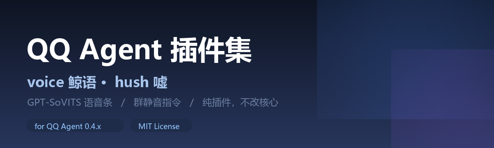

<div align="center">



# QQ Agent 插件集

**给我自己那台机器用的插件仓库 —— 纯插件实现，不改核心代码。**

[](#-环境要求)
[](LICENSE)
[](#-插件列表)

</div>

---

## 📦 插件列表

> **每个插件一个顶层文件夹，文件夹名 = 插件 id**，整个文件夹拷进 `<QQ Agent>/resources/app/plugins/` 即可。

| 插件 | 版本 | 一句话 |
|:---|:---|:---|
| [🎙 **鲸语** `voice/`](voice/) | `1.2.0` | 本地 GPT-SoVITS 合成，把话发成**真正的 QQ 语音条**。中日双语、按语言切音色、中文台词自动翻日语 |
| [🤫 **嘘** `hush/`](hush/) | `2.0.0` | 主人在群里下**静音指令**：四档强度（只回@ / 完全不说话 / 睡觉 / 只回一句礼貌话），静音期间记账，解除时汇报 |

## 🧩 插件速览

### 🎙 鲸语（voice）

让她用「声音」说话，而不是打字。

```text
@她 语音 中文 主人晚上好          → 中文音色念出来
@她 语音 日语 主人晚上好          → 自动译成日语再念
@她 用语音说 早点休息             → 自然语言识别（私聊免 @）
@她 来一句日语                    → 她自己挑一句说
@她 今天吃什么                    → 正常聊天，不发语音
```

- 音色按**语言**选，不按指令里的词选（避免内容里出现"日语"就误判）
- 失败不哑火：翻译挂了用原文，TTS 挂了回退文字
- 详见 [voice/README.md](voice/README.md)

### 🤫 嘘（hush）

群里太吵时让主人一键闭上她的嘴。

```text
@她 /静音 30                      → 只回 @，30 分钟后自动恢复
@她 /静音 完全 30                 → 完全不说话（连 @ 也不回）
@她 /静音 睡觉 8小时              → 睡觉档，醒来会问"刚才谁找我"
@她 /静音 礼貌 30                 → 被 @ 只回一句"我先安静会儿"
@她 /说话                         → 解除，并汇报静音期间来了多少条、被点名几次
```

- 纯插件实现：复用核心的 `commandMute`，再用 `before-tool` 把嘴捂住
- 静音记账存在 `data/hush-state.json`
- 详见 [hush/README.md](hush/README.md)

## 📁 目录结构

```text
QQ-Agent-Skill-and-Plugin/
├── docs/
│   └── banner.png          # 题图
├── voice/                  # ← 鲸语（插件 id: voice）
│   ├── index.js
│   ├── plugin.json
│   └── README.md
├── hush/                   # ← 嘘（插件 id: hush）
│   ├── index.js
│   ├── plugin.json
│   └── README.md
├── LICENSE
└── README.md
```

## 🚀 安装

```text
1. 把需要的插件文件夹（voice/ 或 hush/）复制到
   <QQ Agent>/resources/app/plugins/
2. 重启 QQ Agent，或等它热重载
3. 设置页 → 插件 → 找到对应插件 → 配置
```

> ⚠️ **不要把 `.git` 目录放进 `plugins/`**
> QQ Agent 的加载器会把 `plugins/` 下所有子目录当插件扫描，`.git` 会被当成一个坏插件，日志里多一条加载失败。

## 🔧 环境要求

| 插件 | 依赖 |
|:---|:---|
| 鲸语 | **GPT-SoVITS**（本地 `api_v2`，默认 `127.0.0.1:9880`）+ SnowLuma / OneBot v11 + 3~10 秒参考音频 |
| 嘘 | 只要 QQ Agent 本身（`config.commandMute.enabled = true`） |

## 🧠 共同的设计取舍

| 取舍 | 原因 |
|:---|:---|
| **纯插件，不改核心** | QQ Agent 升级不会冲掉，也不用维护 fork |
| **复用核心已有字段** | 静音用 `commandMute`、语音走 OneBot `record` 段，不另造一套状态 |
| **失败就降级** | 任何外部依赖挂了都不应该让机器人失联 |
| **记账存单独 JSON** | 配置里的数组被核心深合并写坏过两次，独立文件更可靠 |

## 📄 License

[MIT](LICENSE) —— 代码随便用。

> ⚠️ **音色与训练素材的版权归原权利人**。本仓库**不含**任何模型权重或音频素材，请勿商用或公开传播你训练的模型。
